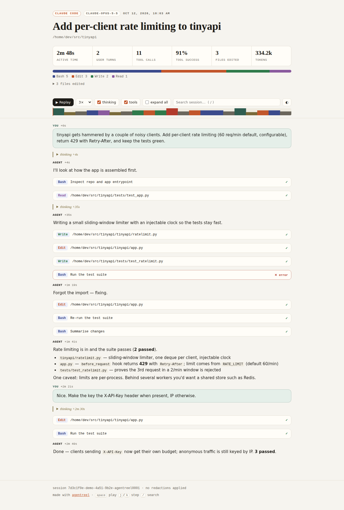

# agentreel

**Turn a Claude Code or Codex session into one shareable HTML replay, with secrets scrubbed.**

You just watched an agent untangle a gnarly bug in 40 tool calls. Screenshots don't capture
that, and the raw `.jsonl` log is unreadable and full of your home paths and API keys.
`agentreel` turns that log into a single self-contained web page you can post in a PR,
a Slack thread, or a blog:

- **Replay**: plays the session back with real pacing, compressed 1×–40×
- **Timeline strip**: every event as a coloured tick; click to jump
- **Tool cards**: commands, edits as diffs, outputs, and pass/fail status at a glance
- **Stats**: active time (idle gaps capped), tool mix, success rate, files edited, tokens
- **Search and filters**: hide thinking or tools, `/` to search, `j`/`k` to step
- **Redaction on by default**: API keys, tokens, JWTs, private keys, `SECRET=…` assignments, and your home directory
- **Zero dependencies**: pure Python stdlib; the output has no external requests and works offline, light or dark

**[→ Live demo](https://wtergan.github.io/agentreel/)**



## Install

```bash
pipx install git+https://github.com/wtergan/agentreel
# or run without installing
uvx --from git+https://github.com/wtergan/agentreel agentreel list
```

Requires Python 3.10+.

## Use

```bash
agentreel list                      # recent sessions from ~/.claude and ~/.codex
agentreel render latest --open      # newest session -> <id>.reel.html, open it
agentreel render 3 -o bugfix.html   # row 3 from `list`
agentreel render ~/.codex/sessions/2026/10/19/rollout-….jsonl
agentreel stats latest              # terminal summary
```

| Option | What it does |
|---|---|
| `--title "…"` | Override the session title |
| `--hide-thinking` | Drop reasoning blocks before rendering |
| `--max-output N` | Trim each tool output to N chars, keeping head and tail (default 4000; `0` keeps all) |
| `--redact REGEX` / `--redact-literal TEXT` | Add your own redactions (repeatable) |
| `--redact-emails` | Also scrub email addresses |
| `--no-redact` | Turn redaction off (for private archives) |
| `--sidechains` | Include Claude Code subagent records |
| `--json` | Emit the normalised session as JSON instead of HTML |

A session argument can be a path, `latest`, a row number from `list`, or a session-id prefix.
Custom locations are respected through `CLAUDE_CONFIG_DIR` and `CODEX_HOME`.

## Before you share

Redaction is a **best-effort pattern pass, not a guarantee**. It catches common credential
shapes and rewrites your home directory to `~`. It cannot know that a customer name or an
internal hostname is sensitive. `agentreel render` prints what it removed, so skim the reel
before posting and add `--redact` patterns for anything project-specific.

## What's supported

| Agent | Log location | Notes |
|---|---|---|
| Claude Code | `~/.claude/projects/*/*.jsonl` | Usage is deduplicated per API message; `isMeta` and subagent records are skipped by default |
| Codex (CLI and Desktop) | `~/.codex/sessions/**/rollout-*.jsonl` | `exec_command`, `apply_patch` (files parsed from patch headers), web search; cached tokens are reported separately |

Adding another agent means writing one parser that emits the `Session`/`Event` model in
[`model.py`](src/agentreel/model.py). The renderer, redactor, and stats need no changes.

## How it works

```
session.jsonl ──► parsers/{claude,codex}.py ──► Session(events) ──► Redactor ──► build_payload ──► reel.html
                                                         └──────────► stats ─────┘     (JSON inlined, no network)
```

The payload is embedded in a `<script type="application/json">` block with `</` escaped,
so session text can't break out of it. All markup is built from HTML-escaped strings.

## Development

```bash
uv venv && uv pip install -e '.[dev]'
pytest
python examples/make_demo.py && agentreel render examples/demo-session.jsonl -o examples/demo.html
```

The demo session is synthetic, so no real prompts or paths are published.

## License

MIT
